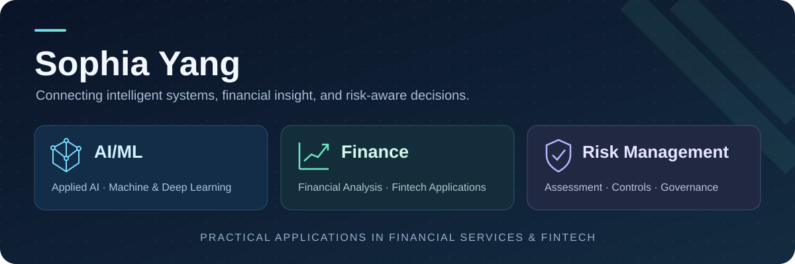

  

<h1 align="center">Hi, I'm Sophia Yang</h1>

<strong>AI/ML · Finance · Risk Management</strong>

Connecting AI/ML with financial knowledge and risk management to develop practical applications in financial services and fintech.

  

## About me

My focus brings together three domains: **AI/ML, Finance, and Risk Management**. I'm interested in translating AI capabilities into useful applications for financial analysis, risk assessment, and decision support in financial services and fintech.

- **AI/ML:** machine learning, deep learning, LLM applications, and numerical computing.
- **Finance:** financial analysis, quantitative methods, and data-informed financial decisions.
- **Risk Management:** risk assessment, controls, governance, and responsible AI adoption in financial services.

My public projects explore interactive AI applications and the computational foundations of machine learning. I value clear documentation, reproducible examples, and careful validation.

## Skills & focus

  
  
  
  
  
  
  
  

| Core domain | Focus |
| :--- | :--- |
| **AI/ML** | Machine learning, deep learning, LLMs, multimodal interaction, embedding retrieval, and GPU computing |
| **Finance** | Financial analytics, quantitative analysis, and practical applications in fintech |
| **Risk Management** | Risk assessment, controls, governance, and AI-supported decision-making in financial services |

**Project toolkit:** Python, JavaScript, NumPy, SQLite, browser audio, AI APIs, and custom CUDA kernels.

## Selected projects

| Project | Focus | Methods & tools |
| :--- | :--- | :--- |
| **[FinTextRiskProject](https://github.com/sophiayang1112/FinTextRiskProject)** | Financial text mining, evidence-grounded risk assessment, and model governance | As-of retrieval, feature fusion, calibration, uncertainty sets, audit trails, and optional local LLM integration |
| **[FraudSignalProject](https://github.com/sophiayang1112/FraudSignalProject)** | Loan-fraud scoring, review prioritization, and transaction-history analysis | Logistic regression, random forest, LightGBM, SMOTENC, customer-disjoint evaluation |
| **[MortgageRiskProject](https://github.com/sophiayang1112/MortgageRiskProject)** | Mortgage-default classification, risk thresholds, and customer segmentation | Six model comparisons, PCA, K-means, t-SNE, feature interpretation |
| **[GPU Programming · Vector Search](https://github.com/sophiayang1112/GPUProgrammingVectorSearch)** | Exact vector retrieval and numerical computing | NumPy reference, custom CUDA kernels, batched search, reproducible benchmarks |
| **[AIEducation](https://github.com/sophiayang1112/AIEducation)** | Conversational AI with speech, vision-assisted tutoring, and local memory | Python, JavaScript, SQLite, and AI APIs; collaborative project |

The financial-risk projects include reproducible synthetic datasets, measured results, and automated tests. FinTextRiskProject publishes offline fusion results; live LLM execution is tracked separately. GPUProgrammingVectorSearch includes CPU validation and optional GPU tests; CUDA execution is pending validation on compatible hardware.

## What I'm exploring next

- Applying AI/ML to financial analysis, risk assessment, and decision support.
- Understanding the tradeoffs between numerical correctness, latency, and memory use.
- Exploring responsible AI applications in financial services and fintech.

---

AI/ML · Finance · Risk Management | Applications in financial services and fintech

