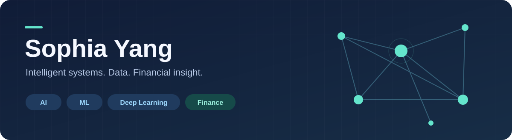

  

<h1 align="center">Hi, I'm Sophia Yang</h1>

<strong>AI · Machine Learning · Deep Learning · Finance</strong>

Exploring how intelligent systems and numerical computing can turn data into useful decisions.

  

## About me

I'm interested in the intersection of AI, software engineering, and finance. My portfolio explores interactive AI applications and the numerical building blocks behind machine learning systems.

- **AI applications:** conversational experiences, speech interfaces, and multimodal interaction.
- **ML & deep learning:** embeddings, vector similarity, tensor operations, and GPU computing.
- **Finance interests:** quantitative analysis, financial data, and applications of machine learning to financial decision-making.
- **Engineering approach:** clear documentation, reproducible examples, correctness checks, and explicit limitations.

## Skills & focus

  
  
  
  
  
  
  
  

| Area | Topics in my portfolio and interests |
| :--- | :--- |
| Artificial intelligence | LLM APIs, conversational applications, speech recognition, speech synthesis, vision-assisted interaction |
| Machine learning & deep learning | Embedding retrieval, cosine similarity, matrix operations, normalization, GPU kernels |
| Software & data | Python, JavaScript, NumPy, SQLite, browser audio, local API services |
| Finance | Interest in quantitative research, financial analytics, risk, and data-informed decisions |

## Featured projects

<table>
<tr>
<td valign="top" width="50%">

### [AIEducation](https://github.com/sophiayang1112/AIEducation)

An AI learning companion combining speech interaction, camera-assisted tutoring, multiple characters, and local conversation memory.

**Built with:** Python · JavaScript · SQLite · AI APIs

A personal assignment completed with collaboration.

[Explore the application →](https://github.com/sophiayang1112/AIEducation)

</td>
<td valign="top" width="50%">

### [VectorRankLab](https://github.com/sophiayang1112/VectorRankLab)

Exact batched vector retrieval with a NumPy reference, custom CUDA kernels, deterministic ranking, and reproducible benchmarks.

**Built with:** Python · NumPy · CUDA · CuPy integration

CPU tests pass; GPU execution remains to be validated on compatible hardware.

[Explore the implementation →](https://github.com/sophiayang1112/VectorRankLab)

</td>
</tr>
</table>

## What I'm exploring next

- Connecting AI and machine learning methods with financial data problems.
- Understanding the tradeoffs between numerical correctness, latency, and memory use.
- Turning small prototypes into well-documented, reproducible software.

---

Interested in opportunities across AI, ML, software engineering, and financial technology.

